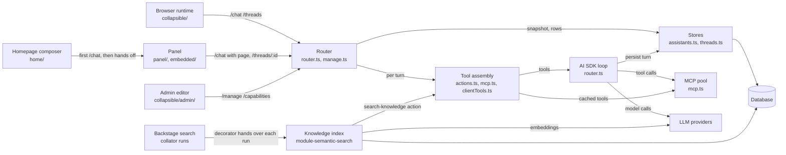
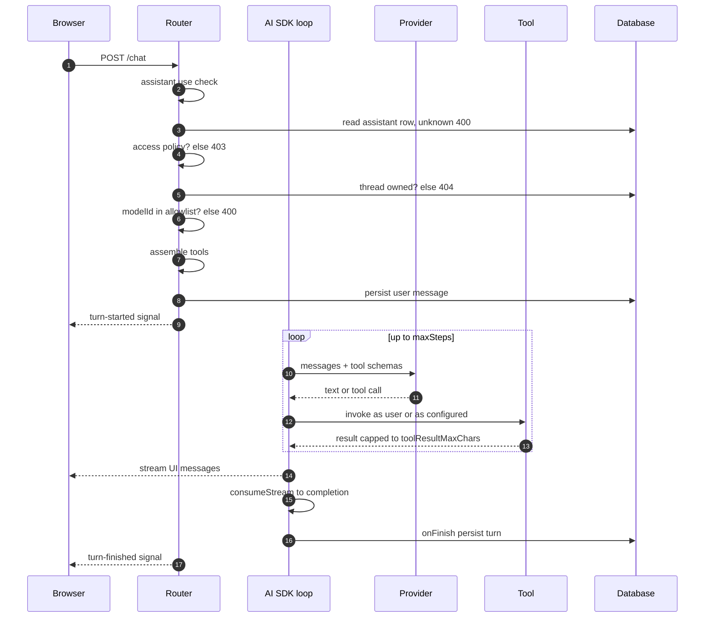
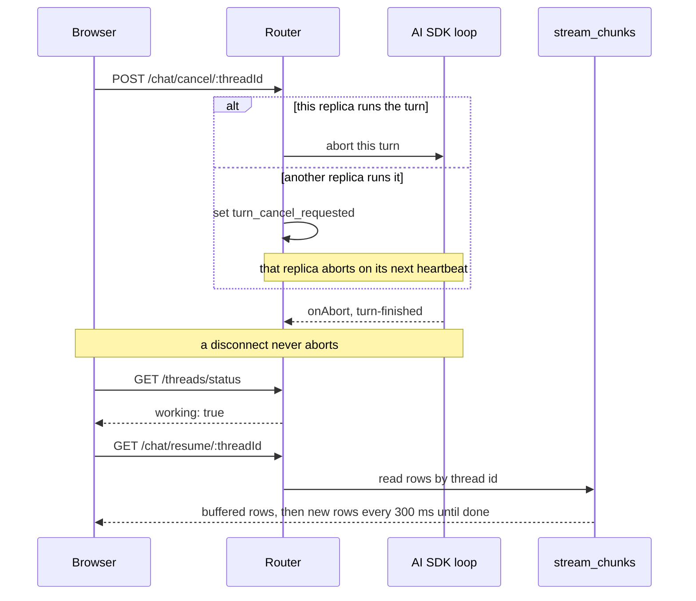
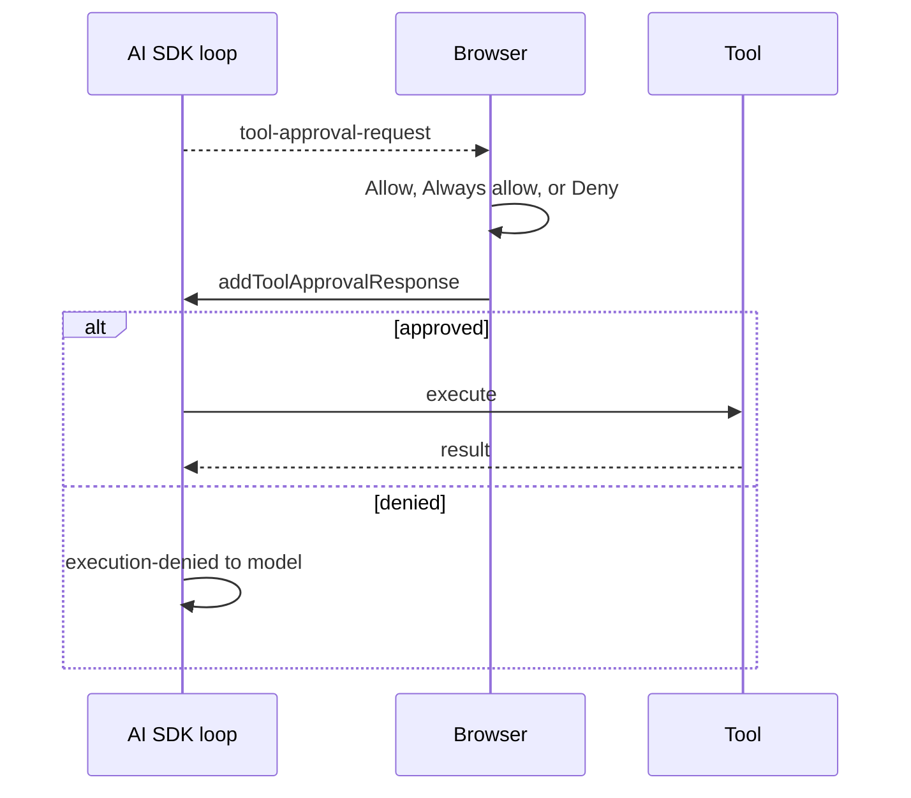
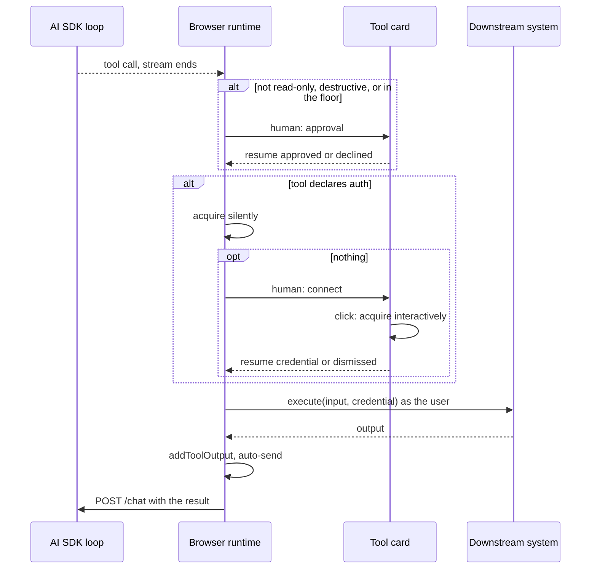
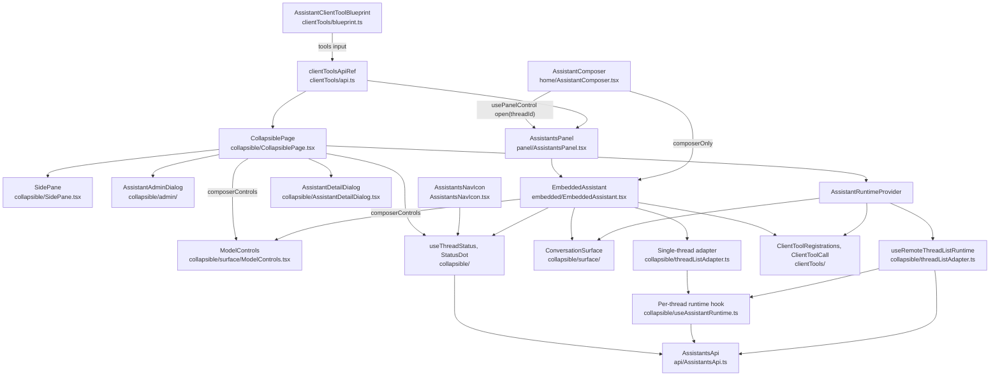
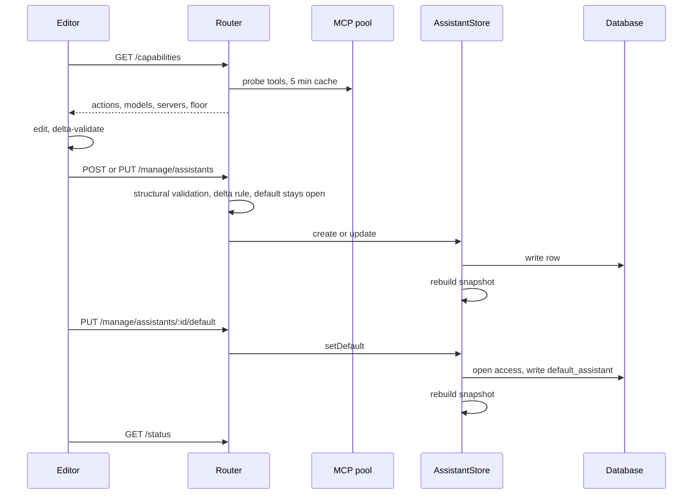
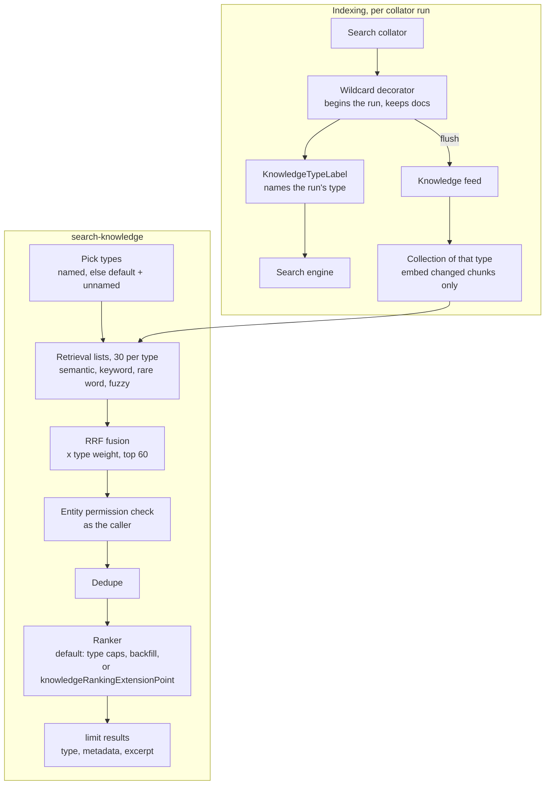

# Architecture

`backstage-assistants` is an in-portal AI chat for Backstage. assistant-ui renders the conversation, the Vercel AI SDK runs the model and tool loop, and Backstage supplies auth, the Actions registry, and the database; the plugin is thin glue between them. This file, [PRINCIPLES.md](PRINCIPLES.md), and [CONTEXT.md](../CONTEXT.md) are the spec, and a change to the design changes them in the same commit.

## Stack

| Package                                                              | Role                                                                                                                                                                                   |
| -------------------------------------------------------------------- | -------------------------------------------------------------------------------------------------------------------------------------------------------------------------------------- |
| `@assistant-ui/react`, `-core`, `-react-markdown`                    | Message and tool-call primitives; `useRemoteThreadListRuntime` is the one runtime for every assistant and conversation                                                                 |
| `@assistant-ui/react-ai-sdk`                                         | `useAISDKRuntime` and `AssistantChatTransport`, the bridge from `useChat` to the runtime; `respondToApproval`; sends registered frontend tools as `tools` and runs them in the browser |
| `ai`, `@ai-sdk/react`                                                | `streamText` tool loop, UI message streaming, `toolApproval`, persistence hooks; `useChat` on the client                                                                               |
| `@ai-sdk/openai`, `-anthropic`, `-azure`                             | Provider factories selected by the configured `type`; OpenAI-compatible gateways use the `openai` factory                                                                              |
| `@backstage/backend-plugin-api/alpha` (Actions), `@ai-sdk/mcp`       | Backstage actions run as the user; MCP servers run as a configured credential or as the user with their own token; both become AI SDK tools                                            |
| `@rjsf/core`, `-utils`, `-validator-ajv8`, `plugin-scaffolder-react` | Inline forms for `render_form`, rendering the host's scaffolder field extensions by name                                                                                               |
| `@backstage/plugin-app-react`                                        | `AppRootWrapperBlueprint` for the panel, which wraps the app layout                                                                                                                    |
| `@backstage/plugin-home-react` (optional peer)                       | `HomePageWidgetBlueprint` for the homepage composer, loaded only through the `./home` entry point                                                                                      |
| `@backstage/backend-plugin-api`, `backend-openapi-utils`             | Plugin wiring, the typed OpenAPI router for `/status` and `/chat`, core services                                                                                                       |
| `coreServices.database` with `knex`                                  | The `threads`, `messages`, `stream_chunks`, `assistants`, `assistants_meta`, and `mcp_tool_cache` tables on SQLite, Postgres, or MySQL                                                 |
| `vector` (pgvector), `pg_trgm`, `ai` `embedMany`                     | The knowledge index module: hybrid semantic, fuzzy, and keyword retrieval in the plugin's Postgres database                                                                            |
| `@backstage/plugin-signals-node`, `-react`                           | Real-time working and unread indicators; the browser polls when the host has no Signals API                                                                                            |
| `mermaid`, `remark-gfm`, `@material-ui/core` v4                      | Diagrams and GitHub-flavoured Markdown in replies; Backstage's component theme                                                                                                         |

The thread and composer components from assistant-ui's registry template are vendored under `packages/assistants/src/collapsible/surface/react-ui/` so they stay editable.

## System map

| Node              | Module path                                                                        | Owns                                                                                            |
| ----------------- | ---------------------------------------------------------------------------------- | ----------------------------------------------------------------------------------------------- |
| Browser runtime   | `packages/assistants/src/collapsible/`                                             | One `useRemoteThreadListRuntime` per tab, the chrome, the surface seam                          |
| Panel             | `packages/assistants/src/panel/`, `embedded/`                                      | The app root wrapper: the floating button, the side panel beside the page, one conversation     |
| Homepage composer | `packages/assistants/src/home.tsx`, `home/`                                        | `AssistantComposer` in four looks; starts the conversation and hands it to the panel            |
| Admin editor      | `packages/assistants/src/collapsible/admin/`                                       | The `assistant.manage` dialog and client-side delta-validation                                  |
| Router            | `packages/assistants-backend/src/router.ts`, `manage.ts`                           | Auth, permission and access checks, `/status`, `/chat`, `/threads`, `/manage`                   |
| Tool assembly     | `packages/assistants-backend/src/actions.ts`, `mcp.ts`, `clientTools.ts`           | `allowedTools` and the request's client tool declarations to AI SDK tools; result capping       |
| AI SDK loop       | `packages/assistants-backend/src/router.ts`                                        | `streamText`, the approval map, persistence on start and finish, signals                        |
| Stores            | `packages/assistants-backend/src/assistants.ts`, `threads.ts`                      | `AssistantStore` with its snapshot; `ThreadService`, the only message writer                    |
| MCP pool          | `packages/assistants-backend/src/mcp.ts`                                           | One client per shared server and one per user of a per-user server, per process; the tool cache |
| MCP OAuth         | `packages/assistants-backend/src/mcpOAuth.ts`, `mcpOAuthRouter.ts`, `secretBox.ts` | Sign-in to servers that run their own OAuth; the sealed token store; refresh                    |
| Knowledge index   | `packages/assistants-backend-module-semantic-search/src/`                          | The search decorator, the index copy, and the `search-knowledge` action                         |
| Database          | Backstage `backend.database`                                                       | The plugin tables, plus the two knowledge index tables on Postgres                              |
| LLM providers     | `packages/assistants-backend/src/config.ts`                                        | The AI SDK provider registry built from config                                                  |

## Routes

Every route accepts user tokens only, except the OAuth sign-in callback and the client metadata document, which are registered as unauthenticated (the callback checks Backstage's user cookie itself). `/chat` applies the per-assistant access policy, and `GET /threads`, `POST /threads`, and `/threads/status` filter or check by it; the per-thread routes and `/chat/resume` and `/chat/cancel` are scoped to the owning user. Handlers live in `router.ts`; `/capabilities` and `/manage/*` live in `manage.ts`; `/mcp/*` lives in `mcpOAuthRouter.ts` and is mounted only when a server uses `provider: oauth`.

| Method | Path                             | Gate                 | Reads                                                                                                      | Writes                                                                           | Signals                              |
| ------ | -------------------------------- | -------------------- | ---------------------------------------------------------------------------------------------------------- | -------------------------------------------------------------------------------- | ------------------------------------ |
| GET    | `/status`                        | `assistant.use`      | snapshot, `actions.list`, MCP tool cache, the config floor                                                 |                                                                                  |                                      |
| POST   | `/chat`                          | `assistant.use`      | assistant row (DB), thread row, `actions.list`, pool, credentials header                                   | `messages`, `threads` `updated_at`, `model`, `last_tokens`, turn state, title    | turn-started, turn-finished, updated |
| GET    | `/chat/resume/:threadId`         | `assistant.use`      | thread row, `stream_chunks`                                                                                |                                                                                  |                                      |
| POST   | `/chat/cancel/:threadId`         | `assistant.use`      | `threads` turn state, abort handle                                                                         | `turn_cancel_requested`                                                          | turn-finished                        |
| GET    | `/threads`                       | `assistant.use`      | snapshot (access filter), `threads`; optional `?assistantId=`; unarchived, pinned first, then `updated_at` |                                                                                  |                                      |
| POST   | `/threads`                       | `assistant.use`      | snapshot (access check)                                                                                    | `threads` row                                                                    |                                      |
| GET    | `/threads/status`                | `assistant.use`      | snapshot, `threads` including turn state                                                                   |                                                                                  |                                      |
| GET    | `/threads/:id`                   | `assistant.use`      | `threads`                                                                                                  |                                                                                  |                                      |
| PATCH  | `/threads/:id`                   | `assistant.use`      | `threads`                                                                                                  | title, model, reasoning level, pinned, archived                                  |                                      |
| DELETE | `/threads/:id`                   | `assistant.use`      | `threads`                                                                                                  | `threads` and `messages` rows                                                    |                                      |
| POST   | `/threads/:id/read`              | `assistant.use`      | `threads`                                                                                                  | `last_read_at`                                                                   | read                                 |
| GET    | `/threads/:id/messages`          | `assistant.use`      | `messages`                                                                                                 |                                                                                  |                                      |
| POST   | `/preview`                       | `assistant.use`      | assistant row (DB), the configured read tool as the caller, credentials header                             |                                                                                  |                                      |
| GET    | `/mcp/oauth/status`              | `assistant.use`      | `mcp_oauth_tokens` for the caller                                                                          |                                                                                  |                                      |
| POST   | `/mcp/:serverId/oauth/start`     | `assistant.use`      | the server's protected-resource and authorization-server metadata, `mcp_oauth_clients`                     | `mcp_oauth_state` row; `mcp_oauth_clients` on first registration                 |                                      |
| GET    | `/mcp/oauth/callback`            | `state`, user cookie | `mcp_oauth_state`                                                                                          | `mcp_oauth_state` row deleted, `mcp_oauth_tokens` row                            |                                      |
| DELETE | `/mcp/:serverId/oauth`           | `assistant.use`      | `mcp_oauth_tokens`, the revocation endpoint                                                                | `mcp_oauth_tokens` row deleted, the user's pooled connection closed              |                                      |
| GET    | `/mcp/oauth/client-metadata/:id` | none                 | config                                                                                                     |                                                                                  |                                      |
| POST   | `/elicitations/:id`              | `assistant.use`      | `mcp_elicitations` (the caller must own the question)                                                      | `response_json`                                                                  |                                      |
| GET    | `/capabilities`                  | `assistant.manage`   | `actions.list`, model pool, MCP pool, `mcp_tool_cache`, the admin's credentials header                     | `mcp_tool_cache`                                                                 |                                      |
| GET    | `/manage/assistants`             | `assistant.manage`   | `assistants` (DB)                                                                                          |                                                                                  |                                      |
| POST   | `/manage/assistants`             | `assistant.manage`   | capabilities                                                                                               | `assistants` row, snapshot rebuild                                               |                                      |
| PUT    | `/manage/assistants/:id`         | `assistant.manage`   | `assistants` row, capabilities                                                                             | `assistants` row, snapshot rebuild                                               |                                      |
| DELETE | `/manage/assistants/:id`         | `assistant.manage`   | the default designation (refused for the default)                                                          | `assistants` row, snapshot rebuild                                               |                                      |
| PUT    | `/manage/assistants/:id/default` | `assistant.manage`   | `assistants` row                                                                                           | `assistants_meta` `default_assistant`, the row's access opened, snapshot rebuild |                                      |

In the browser the page mounts at `/assistants` (`rootRouteRef`); `?assistant=<id>` focuses an assistant and `/assistants/threads/:threadId` (`threadRouteRef`) selects one conversation once, then the URL is replaced with the root path. A thread the caller cannot see is simply absent from the list, so it lands on the normal page with a notice.

`/status` and `/chat` sit on the typed OpenAPI router (`src/schema/openapi.yaml`); the other routes are plain Express sub-routers. The OpenAPI router's JSON parser runs ahead of every route, so `requestBodyLimit` (default `10mb`, sized for `/chat` attachments) is the body limit for all of them. `PATCH /threads/:id` rejects unknown fields; `POST /threads` answers 201; `/chat/cancel` always answers 204; `/chat/resume` answers 204 for an unknown, foreign, or expired stream.

## Chat turn

The browser sends `{ assistantId, modelId, threadId?, reasoningLevel?, messages, tools, page? }`, where `tools` is every registered client tool's declaration (assistant-ui's transport adds `description` and JSON Schema `parameters`; the runtime's fetch wrapper stamps each tool's `attributes`) and `page` is the panel's page context (`path`, `title?`, `entityRef?`), which the router appends to the turn's instructions after the assistant prompt as a note that names the page and the entity and points at `read_current_page`. The note describes that turn only and is never persisted; the page sends no `page`. The server persists the user message before streaming, so the conversation is durable the instant it is sent. A turn without `threadId` streams but is neither persisted, signalled, nor resumable.

Tool assembly splits `allowedTools` into bare action ids, `<serverId>__<tool>` entries whose prefix is a configured MCP server, and `<namespace>__<tool>` client tool names; the server segment is the server id with characters outside `[A-Za-z0-9_-]` replaced by `_`. Action ids are intersected with `actions.list({ credentials })`; unknown names are logged and skipped. MCP entries of a shared server come from the pool cache and run as the server's configured credential. Entries of a per-user server (`userCredentials`) come from the caller's own connection, opened with the token for that server in the `x-assistants-credentials` header (base64 JSON keyed by server id; entries for servers that aren't per-user are ignored); without a token, or when the connection fails, the server offers no tools and the turn's instructions get one line saying so (connect, or the server's error), placed after the assistant prompt. Client tools come from the request's `tools`: a declaration is offered when its name is a built-in (`render_form`, `download_file`, `read_current_page`, `describe_portal`) or in the allowlist, has the client-tool shape, collides with no server tool, and is within limits (30 per request, 4000-character description, 8 KB schema, `parameters` of type object); the rest are logged and dropped. Each becomes a tool with no `execute`. Client tool outputs arrive inside `messages` and are capped to `toolResultMaxChars` there, so the same budget applies before the model call and before persistence. Non-image file parts are inlined as `<attachment>` text before the model call. `reasoningLevel` (`low`, `medium`, `high`, `max`) is translated per provider type in `config.ts`.

The loop runs `streamText` with `stopWhen: stepCountIs(maxSteps)` (default 10) and one `AbortController` per thread. Usage from the last `finish-step` rides the assistant message as `metadata.usage`, and `replaceMessages` stores the total in `threads.last_tokens`. Usage falls back to the turn's total when no step reported any. Errors stream as a readable error part with the real reason, capped at 300 characters. A failed or denied tool call returns a `{ _error: true, message }` result rather than throwing, so the loop continues. A failed action invoke throws a `ResponseError` whose message is only the HTTP status, so the result adds `status` and appends the reason from the response body (the input validation issue, or the action's own error message, never its stack), letting the model correct its input and retry; every tool result, error or not, is truncated to `toolResultMaxChars` (default 30000, `0` disables), keeping the head and tail around an elision marker.

**Auto-title.** After a turn lands, `onFinish` runs `generateText` off the critical path when the title is still `New Chat`. The result is cut to 80 characters, saved with `updateThread`, and announced with an `updated` signal.

### Cancel and resume

A running turn is recorded on its thread: `noteStarted` sets `turn_heartbeat_at`, the replica running the turn refreshes it every 5 s, and `noteFinished` clears it. `working` is a heartbeat younger than 30 s, so every replica reports the same and a replica that dies mid-turn stops reporting within 30 s.

Stop sets `turn_cancel_requested` on the caller's own running turn and aborts it at once when this process runs it; otherwise the running replica reads the flag on its next heartbeat and aborts. A dropped connection does not abort: `consumeStream` drives the turn to completion and `onFinish` persists it.

On entering a conversation the runtime hook checks the `working` flag and calls `resumeStream()`, which targets `/chat/resume/:threadId` with the thread id as the stream id. Any replica serves it from `stream_chunks`, which keeps the turn's rows 60 s after completion. The first row is written before the turn reads as working, so a working turn always has rows to replay; a resume that finds none answers 204. When the replica running a turn dies, the replay ends without a finish once the heartbeat goes stale, and the surface shows "Connection lost".

| End state    | Persisted                                             | Surface shows                                                              |
| ------------ | ----------------------------------------------------- | -------------------------------------------------------------------------- |
| Stopped      | Partial reply, stamped `metadata.canceled: true`      | "Request interrupted", live via `interruptedTurns`, durable via the flag   |
| Errored      | The turn up to the error, including any partial reply | The streamed error part with the reason                                    |
| Disconnected | The full turn, written when the server finishes       | "Connection lost" in the tab that dropped; resume or reload shows the turn |

A clean close with no `finishReason`, outside a form or approval pause, is labelled as disconnected.

## Human in the loop

The approval gate is a global floor in config: `assistants.requireApproval` (action ids and tool names) ∪ each `mcp.servers.*.requireApproval` (tool names, folded in as `<serverId>__<tool>`). Per turn, the set is that floor ∩ the assistant's `allowedTools`. Each server-tool member gets a `toolApproval` entry, so the SDK emits `tool-approval-request` and skips `execute` until the user answers. Allow runs the tool under its normal identity; Deny returns an execution-denied result to the model. Client tools are never in the map, because assistant-ui skips a frontend tool's `execute` for a call that carries a server approval; the browser gates them instead (below). The gate withholds execution and never grants access; Backstage permissions still apply when an approved action invokes.

**Always allow** records an approved response with `reason: always:<tool>`. The `toolApproval` predicate reads it back from the message history, so that tool runs unprompted for the rest of the conversation. The grant is per tool and survives reloads because it lives in the persisted messages. Several gated calls of one tool in a single step collapse into one card with a count; the lowest-index call leads and the rest mirror its decision.

The gated tools of a per-user server take no standing grant unless the server sets `allowStandingApproval`: they are listed in `/status` as `approveEachCall`, the card offers only Allow and Deny, and the predicate ignores an `always:` response for them.

**Argument rules** (`mcp.servers.*.argumentRules`: a `pattern` or an `equals` per argument, compiled at config load) are checked twice. The `toolApproval` predicate checks them first and returns `denied` with the reason, so the SDK answers the request itself (`isAutomatic`) and the user never approves a call that would be refused; the card shows the reason under "Denied". The tool's `execute` checks them again before calling the server, so a tool outside the floor is guarded too. A missing argument fails its rule.

**Write previews.** `/status` carries each `approvalPreview` as `approvalPreviews` (namespaced tool → `type`, field templates, and whether a diff base exists). The card resolves the templates against the call's input (`{owner}/{repo}` interpolates, a bare name reads that argument) and shows `repo · branch · path`, the commit message, and a unified diff drawn by `react-diff-viewer-continued`, lazy-loaded and run without its web worker. With a `base`, the card posts the pending call to `POST /preview`; the router checks the caller may use the assistant and the assistant allows the tool, resolves the configured read tool's arguments from the call's input (for `files`, from the input merged with each file entry), and runs it through the same client the write would use, so a per-user server reads as the user. A not-found error comes back as `exists: false` ("New file"); text is taken from an embedded resource first, then text parts. A diff over 200,000 characters on either side is summarized instead of drawn, and "Show raw input" reveals the JSON.

**Audit.** Each gated call and each rule rejection writes one `assistants.tool.audit` log line with `user`, `assistantId`, `threadId`, `server`, `tool`, `decision` (`approved` or `denied` from the request that carries the answer, then `executed`, `failed`, or `rejected-by-rule`), and `target`: the call's `owner`, `repo`, `branch`, `base`, `head`, `ref`, `path`, `number`, `issue_number`, `pull_number`, `project`, `key`, and `id`, when they are scalars of 200 characters or fewer. Content, messages, and tokens never reach it.

### Questions from MCP servers

A server with `elicitation` (on by default for a per-user server, off for a shared one) may stop mid-call to ask the user for input (MCP `elicitation/create`, form mode). Its clients declare the `elicitation` capability and register a handler with `@ai-sdk/mcp`'s `onElicitationRequest`, which hands the request to `ElicitationBroker` (`mcpElicitation.ts`). Each of the server's tools runs as an async generator (`runAskingUser`) whose call is tracked on the client it runs on while `callTool` is in flight, and `callTool` runs inside `ElicitationBroker.within(call)`, an `AsyncLocalStorage` scope. Over Streamable HTTP a request the server sends on the call's response stream is read inside that scope, so the handler sees exactly which call asked. A request outside any scope (the standalone stream, stdio) goes to the only call in flight on the client; with several calls of one user, to one that hasn't asked yet (else one with nothing open), and the question names no tool; with several users' calls (a busy shared server) it is refused. Questions on one call are asked one after another (`ElicitationCall.turn`); calls in the same conversation each show theirs at once. A refusal throws `ElicitationRefused`, which `@ai-sdk/mcp` returns to the server as a JSON-RPC error rather than a user's `cancel`: no call, a request that didn't say the browser renders forms (`elicitation: true` on `/chat`), more than three questions in one call, URL mode, or a schema outside MCP's restricted subset. The question is cancelled at `mcp.elicitationTimeoutMs` (5 minutes by default) and when the turn stops. A routed question is stored in `mcp_elicitations` and shown on the call as a preliminary tool output, `{ _elicitation: ElicitationPrompt }` (id, server and title, tool, message, requested schema, expiry, status). The AI SDK streams every preliminary output to the browser and gives the model only the final one, so the model never sees the question or the answer, and `streamBuffer` replays the question to a client that rejoins. `ToolFallback` renders the marker as `ElicitationCard`: the fields parsed by `parseElicitationSchema` (text with formats and lengths, numbers with bounds, a checkbox, a radio group for five choices or fewer and a select above that, checkboxes for a multi-select), Submit and Decline (no Cancel: the broker sends `cancel` when the user stops the turn, lets it time out, or leaves), with a warning and Decline as the main button when a field looks like a secret. The answer is posted to `POST /elicitations/:id`, which answers 403 for another user, 410 for a settled or expired question, and 400 with the problems for an answer `validateElicitationContent` rejects (the second such answer cancels it). The broker on the replica running the call takes the answer at once when it was posted there and otherwise from the row (polled every second), returns it to the server, updates the call's output to the outcome (with the names of the fields answered), and keeps the row with the action only, no values, until it expires. While a question is open the call's 60-second ceiling (`pausableTimeout`) stops counting, so only `elicitationTimeoutMs` bounds the wait. A question left open by a turn that stopped renders as cancelled. Submit is enabled once the answer passes `validateElicitationContent`. How each call's last question ended is collected on the turn (`McpTurn.elicitations`, by tool call id) and stamped on the saved reply as `metadata.elicitations`; `ToolFallback` marks a call whose question was declined, cancelled, or expired with a warning icon and the outcome, from the live preliminary output during the turn and from that metadata after a reload. Each question writes an `assistants.tool.audit` line with `decision: 'elicitation'`, the action, and the field names.

### Client tools

A client tool is contributed by any frontend plugin or module with `AssistantClientToolBlueprint`, which attaches to the `tools` input of `api:assistants/client-tools`. Every surface that runs a conversation (the page, the panel, the homepage composer) reads that registry and registers each tool with assistant-ui (`useAssistantTool`): a tool with `execute` as `type: frontend`, one without as `type: human`. assistant-ui then sends the tool's schema with every `/chat` request, runs `execute` in the browser once the model's call is complete and the server stream has ended, and renders the tool's card for the call. `isAvailable` is resolved once per page load; an unavailable tool is registered disabled, so it is neither sent nor run.

The runtime's `execute` wrapper runs the steps in order and returns a `{ _error: true, code, message }` result instead of throwing: `declined`, `not_authorized`, `timeout` (default 30 s, at most 120 s), `aborted` (the user stopped the turn), or `failed`. Approval precedes credential acquisition, so a declined call never prompts for a login. The prompts use assistant-ui's `human` interrupt: the card receives the request as `interrupt` and answers with `resume`. Connect runs the interactive acquisition in the click handler, so the provider's popup is never blocked, and hands the credential to the waiting `execute` through `resume`; the credential never enters a result, a request to the backend, or storage. The result is JSON round-tripped; a non-JSON value is a `failed` result. There is no Always allow for client tools. A prompt survives a page reload: assistant-ui re-runs a frontend tool call restored from history without a result, so the wrapper asks again (approval, then Connect if the credential is gone) and the turn resumes once answered.

`render_form`, `download_file`, `read_current_page`, and `describe_portal` are the plugin's own client tools, registered through the same blueprint. `render_form` has no `execute`: it renders through scaffolder's RJSF `Form` with the field registry from `formFieldsApiRef.loadFormFields()`, `ui:*` keys inside the schema are hoisted by `extractSchemaFromStep`, and submit returns `{ submitted: true, values }` while dismissal returns `{ submitted: false, cancelled: true }`. `download_file` renders a download chip from the call's input and its `execute` returns `{ delivered: true }`. `read_current_page` (`clientTools/builtin/pageSerializer.ts`) returns the rendered page as an outline: open dialogs and drawers first under a `[dialog: …]` line, then `main` (the body when there is none, with the chrome skipped), walking headings, text, `[button: …]`, `[link: …, current]`, `[tab: …, selected]`, `[input: label = value]`, tables as rows, alerts, and monospace regions cut to their first 80 lines or, with `find`, the 10 lines around each of the first 10 matches; capped at 12,000 characters with a marker. The panel and the strip are skipped; visibility is a layout check. `describe_portal` (`clientTools/builtin/portalDescription.ts`) reads `appTreeApiRef`, which the core app provides whether or not the visualizer plugin is installed, and returns the rendered (not disabled, not orphaned) nodes' plugins, the top-level pages (a `page:` node with no routed ancestor) with their full paths joined from every routed ancestor, the tabs under `page:catalog/entity` with `:param` path templates, the app title, and the registered client tool names; titles come from the node's `core.title` data, else the plugin title. None of the four is config-gated; an app disables `read_current_page` or `describe_portal` through its extension id.

`sendAutomaticallyWhen` flushes the turn once every tool part in the latest step is settled and at least one is client-driven: a client tool's output, unless it records that the user stopped the turn, or an answered approval. A server tool truncated at `maxSteps` is never auto-resumed.

## Authorization

| Order | Layer                       | Where                                                          | Rule                                                                                                                                                                                                                                                                                                                                                          |
| ----- | --------------------------- | -------------------------------------------------------------- | ------------------------------------------------------------------------------------------------------------------------------------------------------------------------------------------------------------------------------------------------------------------------------------------------------------------------------------------------------------- |
| 1     | `assistant.use` permission  | Every user-facing route; the page via `usePermission`          | Denied callers get 403 and never load the surface                                                                                                                                                                                                                                                                                                             |
| 2     | Per-assistant access policy | `/status` filter, `/chat`, `/threads` list, create, and status | `allowAuthenticated`, or `users` contains the caller, or `groups` meets `ownershipEntityRefs`; deny by default. The API defaults a missing policy to deny; the editor pre-fills open                                                                                                                                                                          |
| 3     | Tool selection              | Tool assembly                                                  | Backstage actions: `allowedTools` ∩ `actions.list(credentials)`, with per-resource checks at `invoke`. MCP tools: added directly, run as the server credential, or, for a per-user server, as the user's own token, so the remote system caps them at the user's access. Client tools: `allowedTools` ∩ the request's declarations, run in the user's browser |
| 4     | Approval gate               | `toolApproval` in the loop; the runtime's `execute` wrapper    | Floor ∩ `allowedTools` for server tools; the floor plus every non-read-only or destructive tool for client tools; a human checkpoint, not a permission                                                                                                                                                                                                        |

`assistant.manage` gates `/manage/*`, `/capabilities`, and the gear. Both permissions live in `-common`, are registered with `coreServices.permissionsRegistry`, and are granted by the host's permission policy. Hiding the nav entry is the host app's job.

| Call                             | Runs as                                                                                                                                 |
| -------------------------------- | --------------------------------------------------------------------------------------------------------------------------------------- |
| `/chat`, `/threads*`, `/status`  | The signed-in user's token                                                                                                              |
| Backstage action `execute`       | The calling user's credentials, via `actions.invoke`                                                                                    |
| Built-in actions                 | On-behalf-of tokens for `search` and `techdocs`, minted from the caller                                                                 |
| `search-knowledge` result filter | An on-behalf-of `catalog` token minted from the caller                                                                                  |
| Knowledge index copy             | None: it copies documents search collected with each collator's own credentials                                                         |
| MCP tool `execute`               | The server's static `headers` or `env`; one identity for every user                                                                     |
| Per-user MCP tool `execute`      | The user's own token from the credentials header, in the server's configured header or environment variable                             |
| OAuth MCP tool `execute`         | The user's token for that server, held by the backend, as `Authorization: Bearer`                                                       |
| `/preview` read                  | The same client the previewed write would use                                                                                           |
| Client tool `execute`            | The user's browser, with a credential the user's own session or consent provides; the downstream system enforces the user's permissions |
| `/capabilities` action list      | The admin's credentials, so assignable can exceed runnable                                                                              |

A low-privilege user chatting with an assistant wired to a powerful shared MCP server gets that server's full configured access. Choose shared servers and their credential scope deliberately; a per-user server gives the model only what the user's own token allows, and attributes its writes to the user. A client tool gives the model only what the user already has, since it runs as the user; the browser decides which tools to declare, but the allowlist decides which are offered, and a user forging a declaration can only run code in their own browser with their own credentials.

## State and lifetime

| Store                                | Where          | Scope                             | Written by                                                          | Lifetime                                                                      | Several replicas                               |
| ------------------------------------ | -------------- | --------------------------------- | ------------------------------------------------------------------- | ----------------------------------------------------------------------------- | ---------------------------------------------- |
| `threads`, `messages`                | DB             | Per `user_ref`                    | `ThreadService` from `/chat` and `/threads`                         | Durable                                                                       | Shared                                         |
| `assistants`, `assistants_meta`      | DB             | Global                            | `AssistantStore` from `/manage`, seed-once                          | Durable                                                                       | Shared                                         |
| `assistants_knowledge_*`             | DB             | Global                            | The replica that ran the search collator, one run at a time         | Rebuildable copy; rebuilt when the embedding model changes                    | Shared                                         |
| Assistant snapshot                   | Process memory | Global                            | Write-through on the editing replica                                | Lazy refresh after 60 s elsewhere                                             | Stale up to 60 s; `/chat` reads the row        |
| `stream_chunks`                      | DB             | Per thread, owner-checked on read | `StreamBuffer` from the `consumeSseStream` tee                      | Replaced by the next turn; deleted 60 s after completion; swept after an hour | Shared                                         |
| Turn state                           | DB             | Per thread                        | `noteStarted`, a 5 s heartbeat, `noteFinished`                      | Cleared on finish, abort, or error; stale after 30 s                          | Shared                                         |
| Abort handles                        | Process memory | Per thread                        | `/chat`                                                             | Cleared on finish, abort, or error                                            | A cancel elsewhere lands on the next heartbeat |
| MCP pool and tool cache              | Process memory | Per server                        | `maintainMcpConnections` every 2 min                                | Until shutdown; 5 min freshness for `/capabilities`                           | Each replica keeps its own                     |
| Per-user MCP connections             | Process memory | Per server and user               | `/chat`, `/preview`, `/capabilities` with the user's token          | Reconnected when the token changes; closed after 10 min idle; at most 200     | Each replica keeps its own                     |
| `mcp_tool_cache`                     | DB             | Per per-user server               | The first listing after a change, from any user's connection        | Rebuildable; replaced by each changed listing                                 | Shared                                         |
| `mcp_oauth_tokens`                   | DB             | Per server and `user_ref`         | The sign-in callback; each refresh                                  | Until disconnect, or a refresh the server refuses                             | Shared                                         |
| `mcp_oauth_clients`                  | DB             | Per OAuth server                  | The first sign-in, by dynamic client registration                   | Durable; deleted when the server rejects the client                           | Shared                                         |
| `mcp_oauth_state`                    | DB             | Per sign-in, bound to `user_ref`  | `/mcp/:serverId/oauth/start`                                        | Deleted by the callback; swept after 10 min                                   | Shared                                         |
| `mcp_elicitations`                   | DB             | Per question, owned by `user_ref` | `ElicitationBroker.handle`; the answer from `/elicitations/:id`     | The action only once settled; swept a minute after expiry                     | Shared                                         |
| Calls in flight per MCP client       | Process memory | Per client                        | `runAskingUser` while `callTool` runs                               | Released when the call settles                                                | Each replica keeps its own                     |
| OAuth refresh lock                   | Process memory | Per server and user               | `McpOAuthService.accessToken`                                       | Released when the refresh settles                                             | Each replica keeps its own                     |
| OAuth connections                    | Browser memory | Per tab                           | `ToolGuardsProvider` from `/mcp/oauth/status`                       | Refetched after Connect and Disconnect                                        | n/a                                            |
| Runtime messages                     | Browser memory | Per tab                           | `useChat` stream, history adapter load                              | Until unmount; never persisted                                                | n/a                                            |
| Thread status rows                   | Browser memory | Per tab                           | `useThreadStatus` refetch                                           | Until unmount                                                                 | n/a                                            |
| `interruptedTurns` reasons           | Browser memory | Per message id                    | `useChat.onFinish`                                                  | Cleared on reload; the DB flag takes over                                     | n/a                                            |
| Model and effort refs                | React refs     | Per tab                           | The composer's `ModelControls`; PATCHed to the thread               | Until unmount                                                                 | n/a                                            |
| Side pane collapsed                  | `localStorage` | Per browser                       | The collapse control                                                | Persistent                                                                    | n/a                                            |
| Panel conversation, width, pick, pin | `localStorage` | Per browser                       | `panelStorage` from the panel                                       | Persistent; the conversation is forgotten on "+" and "Open in Assistants"     | n/a                                            |
| Panel mode                           | React state    | Per tab                           | The button, Close, Escape, click-off, `Ctrl+/`, `PanelControl.open` | Until reload; closed on load                                                  | n/a                                            |
| Default assistant                    | DB             | Global                            | `setDefault` from "Make default", the seed, `ensureDefault` at init | Durable; read with the snapshot                                               | Shared                                         |
| Active assistant                     | URL            | Per tab                           | `?assistant=<id>`, rewritten on each switch                         | Survives reload                                                               | n/a                                            |
| Nav icon status rows                 | Browser memory | Per tab                           | `AssistantsNavIcon`'s own `useThreadStatus`                         | Until unmount                                                                 | n/a                                            |
| Scaffolder field registry            | Module memory  | Per tab                           | `render_form`'s first `loadFormFields()`                            | Until reload                                                                  | n/a                                            |
| Client tool prompts                  | Browser memory | Per tool call                     | The runtime's `execute` wrapper via `human`                         | Until answered or the turn stops; a reload re-runs the call and asks again    | n/a                                            |

Turn state and the stream buffer are in the database, so `working`, Stop, and rejoining a running reply work on any replica. The abort handles live in process memory; a Stop received elsewhere reaches them through the heartbeat.

## Data model

`threads`

| Column                                       | Notes                                                           |
| -------------------------------------------- | --------------------------------------------------------------- |
| `id`                                         | Primary key, UUID                                               |
| `assistant_id`                               | Owning assistant; immutable                                     |
| `user_ref`                                   | Owner; every read and write is scoped to it                     |
| `title`                                      | 512 characters; defaults to `New Chat`, the auto-title sentinel |
| `model`, `reasoning_level`                   | Last model id; nullable chosen effort                           |
| `last_tokens`                                | Input plus output of the latest turn; drives the context gauge  |
| `turn_heartbeat_at`, `turn_cancel_requested` | Set while a turn runs; a Stop for the replica running it        |
| `pinned`, `archived`                         | List state                                                      |
| `created_at`, `updated_at`, `last_read_at`   | Timestamps; `last_read_at` nullable                             |

`stream_chunks`

| Column       | Notes                                                             |
| ------------ | ----------------------------------------------------------------- |
| `id`         | Auto-increment; the replay order                                  |
| `thread_id`  | The thread the turn runs on; one turn's rows per thread at a time |
| `turn_id`    | UUID per turn; a new id ends followers of the previous turn       |
| `data`       | UI message stream text, one 250 ms batch; `LONGTEXT` on MySQL     |
| `done`       | Set on the final row of a turn                                    |
| `created_at` | Drives the hourly sweep of abandoned rows                         |

`mcp_tool_cache`

| Column       | Notes                                                      |
| ------------ | ---------------------------------------------------------- |
| `server_id`  | Primary key; a per-user MCP server id                      |
| `tools_json` | The server's tools with input schemas; `LONGTEXT` on MySQL |
| `updated_at` | When the listing last changed                              |

`mcp_oauth_tokens`

| Column       | Notes                                                                                     |
| ------------ | ----------------------------------------------------------------------------------------- |
| `user_ref`   | With `server_id`, the primary key                                                         |
| `server_id`  | A server with `provider: oauth`                                                           |
| `tokens_enc` | The token response (access and refresh token, authorization server), sealed (AES-256-GCM) |
| `expires_at` | From `expires_in`; nullable                                                               |
| `updated_at` | Last sign-in or refresh                                                                   |

`mcp_oauth_clients`

| Column          | Notes                                                     |
| --------------- | --------------------------------------------------------- |
| `server_id`     | Primary key                                               |
| `client_enc`    | The registration response (client id, any secret), sealed |
| `registered_at` | When the backend registered                               |

`mcp_oauth_state`

| Column       | Notes                                                                               |
| ------------ | ----------------------------------------------------------------------------------- |
| `state`      | Primary key; 32 random bytes, base64url                                             |
| `user_ref`   | The user who started the sign-in                                                    |
| `server_id`  | The server signed in to                                                             |
| `flow_enc`   | The PKCE verifier, the client used, and the authorization server's identity, sealed |
| `expires_at` | Ten minutes after the start; indexed for the sweep                                  |

`mcp_elicitations`

| Column                  | Notes                                                                             |
| ----------------------- | --------------------------------------------------------------------------------- |
| `id`                    | Primary key, UUID; the question's id                                              |
| `user_ref`, `thread_id` | Whose turn asked, and its conversation                                            |
| `server_id`, `tool`     | Who asked, during which call                                                      |
| `requested_schema_json` | The server's schema, to validate an answer on any replica                         |
| `attempts`              | Answers rejected so far; the second cancels                                       |
| `response_json`         | The answer while it travels to the replica running the call, then its action only |
| `expires_at`            | `elicitationTimeoutMs` after the question                                         |

Sealed values are `v1.<key id>.<iv>.<tag>.<ciphertext>`; the key id is a hash prefix of the key, so a value sealed under a key in `mcp.oauth.previousEncryptionKeys` still opens and is resealed under the current key when next used.

`messages`

| Column         | Notes                                                 |
| -------------- | ----------------------------------------------------- |
| `id`           | Primary key; the assistant-ui message id              |
| `thread_id`    | Parent thread; deleted explicitly with the thread     |
| `parent_id`    | Prior message                                         |
| `role`         | `user`, `assistant`, or `system`                      |
| `content_json` | The `UIMessage` verbatim; `TEXT`, `LONGTEXT` on MySQL |
| `sort_order`   | Position in the thread                                |
| `created_at`   | Written, never read back                              |

`assistants`

| Column                                                 | Notes                                                                                                                               |
| ------------------------------------------------------ | ----------------------------------------------------------------------------------------------------------------------------------- |
| `id`                                                   | Server-generated UUID; immutable                                                                                                    |
| `title`                                                | Mirrored column for sorting                                                                                                         |
| `definition_json`                                      | `TEXT`, `LONGTEXT` on MySQL: `title`, `description?`, `color?`, `prompt`, `access`, `allowedTools`, `models`, `defaultModel`, `ui?` |
| `created_by`, `created_at`, `updated_by`, `updated_at` | Audit columns                                                                                                                       |

`assistants_meta` holds two keys: `seeded`, the seed-once marker with the seed timestamp, and `default_assistant`, the default assistant's id. The default is a single key rather than a column so there can never be two.

`assistants_knowledge_chunks` (knowledge index module, Postgres only)

| Column          | Notes                                                                                                                         |
| --------------- | ----------------------------------------------------------------------------------------------------------------------------- |
| `id`            | SHA-256 of the document location and chunk position; stable across runs                                                       |
| `collection`    | The search document type the chunk came from: its name, or a UUID for a type not named in config, recognized by its locations |
| `type`          | The named document type; null for a type not named in config; indexed                                                         |
| `entity_ref`    | The entity whose catalog read access gates the chunk; null for everyone                                                       |
| `location`      | The search result location; TechDocs `/docs/...` paths go to `read-techdocs`                                                  |
| `title`         | Heading path, `Site › Page › Section` for TechDocs                                                                            |
| `content`       | Up to ~1600 characters                                                                                                        |
| `content_hash`  | SHA-256 of the embedded text; unchanged hash = not re-embedded                                                                |
| `metadata`      | `jsonb`: the short fields the collator attached (strings ≤ 200 chars, numbers, booleans; at most 16)                          |
| `metadata_hash` | SHA-256 of the metadata; a change alone rewrites `metadata` without re-embedding                                              |
| `embedding`     | `vector(n)` for the configured model; HNSW cosine index up to 2000 dimensions                                                 |
| `tsv`           | Generated `to_tsvector('english', title \|\| ' ' \|\| content)`; GIN index                                                    |
| `updated_at`    | Last upsert                                                                                                                   |

A GIN `gin_trgm_ops` index covers `title || ' ' || content`. `assistants_knowledge_collections` holds each collection's `type` and `refreshed_at`. `assistants_knowledge_meta` holds the index signature, `key = embedding`, `value = <embeddingModel>#<dimensions>#<schemaVersion>`; a different signature drops and recreates the chunk and collection tables, except schema version 2 with the same model, which gains the `type` and metadata columns in place and keeps its embeddings. Both tables are a rebuildable cache, created by the module rather than migrations.

**Unread and recency.** `updated_at` moves only in `replaceMessages`: when a turn starts and when it lands. A new thread starts read: `last_read_at` is its creation time. `unread = updated_at > last_read_at` when `last_read_at` is set. Rename, model, effort, pin, and archive edits touch only their own fields, so editing a conversation never marks it unread or reorders the list.

Timestamps are ISO 8601 strings on every driver; `toIsoTimestamp` converts Postgres `Date` values so ordering and the unread compare see one format. Assistant rows that fail to parse are skipped on read. Threads whose assistant is gone are filtered out of every list but stay in the database with their messages. `messages.thread_id` cascades on delete.

## Frontend runtime

One runtime carries every conversation across all assistants; switching assistant or conversation never remounts it, so in-flight streams keep running. The thread-list adapter lists every thread over `/threads`; the page filters by the active assistant. New conversations are created only by the "+" control or the empty state's New chat button; typing never creates one. Deleting the active conversation lands on the assistant's most recent remaining one. Expanded, `SidePane` holds the assistant list, the conversation list, and the gear; collapsed, `CollapsiblePage` renders a 56 px rail with the same controls as icons. `?assistant=<id>` selects the initial assistant and follows every switch.

The runtime hook runs once per active thread: `useChat` wrapped by `useAISDKRuntime`. Its `AssistantChatTransport` wraps the authed fetch to inject `assistantId`, `modelId`, `reasoningLevel`, and, from the panel, `page` (`getPageContext`, derived from the location and the document title), copies the transport's `id` to `threadId`, and stamps each client tool's `attributes` onto the `tools` the transport built. It sets `elicitation: true`, since the tool call renders an MCP server's questions. It also sets the `x-assistants-credentials` header from `ToolGuardsProvider`: for each per-user server of the thread's assistant, the user's token from Backstage's SCM auth (`scmAuthApiRef`, when the server names a `host`) or the provider's auth API, asked with `optional: true` on every request so no popup opens mid-turn and refreshed tokens are picked up. A server that runs its own OAuth is left out of the header: the backend holds its tokens, and `ToolGuardsProvider` only reads `/mcp/oauth/status`. Its Connect (`signInWithPopup`) opens the popup synchronously in the click, has the backend issue Backstage's user cookie (`/.backstage/auth/v1/cookie`), posts `/mcp/:serverId/oauth/start`, navigates the popup to the returned authorization URL, and waits for the callback page's `assistants-mcp-oauth` message from the backend's origin, or for the popup to close; either way it refetches the status. When the request signal aborts it posts `/chat/cancel/:threadId`. Contributed client tools attach to `api:assistants/client-tools` (`clientToolsApiRef`), one registry the page and the panel both read, instead of a page input with multiple attachment points. `ClientToolsProvider` wraps the page with those tools and the approval floor from `/status`; `ClientToolRegistrations` registers them inside the runtime provider, so one registration serves every conversation. The history adapter is load-only over `/threads/:id/messages`, and its `append` is a no-op. The thread-list adapter's `generateTitle` returns an empty stream because the server writes titles.

**The panel.** `assistantsPanelModule` is a module for the `app` plugin whose one extension, `app-root-wrapper:app/assistants-panel`, renders `AssistantsPanel` around the app layout: inside the router and after sign-in, once per session, so it never remounts on navigation and a streaming answer survives it. A wrapper rather than an app-root element because the panel takes space from the page instead of covering it: the wrapper is a flex row of the page column (`flex: 1`, `min-width: 0`) and a sticky, clipping panel column whose width animates between 0, the strip, and the panel. The app adds the module to its features. The button (a floating action button with the plugin icon and the conversation's own status dot) is hidden on the Assistants page, for a user without `assistant.use`, and while `/status` lists no assistant. The panel has three states: closed (the button only), open (the panel, no button), and collapsed (a 48 px strip at the right edge: the expand chevron at the top, the icon with its status dot at the bottom where the button sits; clicking it reopens). `Esc`, or a mousedown on the page outside the panel and any MUI modal, popper, tooltip, or `role="dialog"`, collapses it unless the header pin is on (`Esc` yields to an open Backstage dialog or drawer); `Ctrl+/` toggles either way, and Close (the x) returns to closed. No backdrop and no focus trap: the page beside it stays usable. Because the panel column clips and the page column shrinks, nothing ever reaches past the viewport (an overlay drawer's slide flashed a horizontal scrollbar and shifted the page). When the column's width transition ends, and after a drag resize, the panel dispatches a window `resize` event, because content that measures itself only on window resize (the home page's grid, charts) would otherwise keep its old width and run under the panel. `Ctrl+/` toggles, the left edge resizes (also with arrow keys), and below the `xs` breakpoint it fills the screen. It remembers its conversation and width in `localStorage`; a conversation stays mounted while the panel is collapsed or closed so a stream keeps rendering, but only an open panel focuses it (`active`), so a reply that lands while the panel is hidden stays unread and the strip or the button shows the red dot until the panel opens again.

**Living beside Backstage overlays.** Dialogs and drawers open beside the panel column, never over it. The panel writes the column's width to the `--assistants-panel-inset` CSS variable on `<html>`, and a global rule sets `right` from it (with `!important`, since MUI sets the modal root's position inline) on `.MuiDialog-root`, `.MuiDrawer-modal`, `.MuiDrawer-paperAnchorRight`, and the Backstage UI dialog overlay; the full-viewport roots also get `width: auto`, so their backdrops end at the column and a dialog centers in the page area. The floating button sits above modals (`zIndex.modal + 1`) so the panel can always be opened. Clicking or typing in the panel leaves an overlay open: the panel column and the button carry `data-react-aria-top-layer`, which Backstage UI's react-aria dialogs treat as outside their dismiss, focus-containment, and aria-hiding rules; for MUI, the inset backdrop no longer covers the panel, and a nested `ThemeProvider` sets `props.MuiModal.disableEnforceFocus`, so an open MUI dialog or drawer no longer pulls focus back from the composer. Their backdrop click and `Esc` still close them.

`EmbeddedAssistant` is the page's layering without the chrome: the `assistant.use` gate and `/status`, `ClientToolsProvider`, the base url, `useRemoteThreadListRuntime` over the single-thread adapter with the same `makeRuntimeHook`, `ClientToolRegistrations`, a header (the assistant picker, "+", history, "Open in Assistants", hide, close; `composerOnly` keeps only the picker), and `ConversationSurface` with a compact class. Its assistant is `resolvePanelAssistant`: the user's pick from the header menu when still accessible, else `defaultAssistant`, else the first accessible; the menu appears only with more than one accessible assistant, and a pick starts a fresh conversation under it (`panelStorage` remembers the pick and notifies subscribers: the panel and the homepage composer each subscribe, so a pick in one switches the other at once; the panel starts fresh under it, and the composer remounts). The header's history button fetches `GET /threads?assistantId=` when opened and lists the ten most recent conversations; picking one remembers it and remounts the surface on it. The model and effort start as the thread's saved choice (adopted once the thread lists) or the assistant's default, are changed from the composer's `ModelControls`, and are PATCHed to the thread. The single-thread adapter's `list()` returns the remembered thread fetched by id, or nothing (a 404 lists as nothing); `initialize()` creates the thread on the first send, and the surface reports the new id through `onThreadChange`. "+" and "Open in Assistants" forget the thread and remount the surface, so a conversation has one client at a time; the page then resumes any in-flight stream by thread id as it does for its own threads.

**The homepage composer.** `assistantsHomeModule` (the `./home` entry point, a module for this plugin) is one `HomePageWidgetBlueprint` widget, `home-page-widget:assistants/AssistantComposer`, attached to the home page's public `widgets` input; the app's `page:home` `defaultConfig` places it by the name `AssistantComposer` (the blueprint's `params.name`, which the grid keys on). Its config is `variant` (`bar`, `padded` by default, `full`, `titled`), `title`, and `width` (the composer's percentage of the card, 20 to 100; 100 for `bar` and 80 otherwise by default, through the `--assistant-composer-width` variable); the factory sets the card `title` only for `titled` and fixes the grid height per variant (2, 3, 3, 4 rows). `AssistantComposer` (exported from `./home`) mounts `EmbeddedAssistant` with `composerOnly`: the same runtime, header, and `ConversationSurface` as the panel, with the thread viewport showing only its footer (the composer, at 80% of the width) and the panel controls hidden. `padded` and `titled` frame it inside the card's padding; `full` cancels the padding; `bar` adds `bare`, which hides the header and asks the surface for `composerMinimal`, the stock one-row composer (input and send), at the configured width on a transparent background. The surface renders nothing for a user without `assistant.use`. The first send creates the thread through the surface's runtime. The thread exists before its turn reaches the server, and the receiving surface checks `working` only once when it decides whether to rejoin, so in `composerOnly` the surface reports the id through `onThreadChange` only once `/threads/status` shows the turn running (polled every 250 ms), its own run has ended, or 30 seconds have passed; a replica that starts the turn late would otherwise leave the panel on an empty thread. The card then calls `usePanelControl().open({ threadId })` and remounts itself on a fresh thread. The panel lists the thread and resumes its stream by id (the turn keeps running on the server; the card's client is gone), so nothing is copied. The thread's model and effort are the ones chosen in the card's composer, persisted by the turn. `usePanelControl().open({ threadId })` is the hand-off: the panel wrapper provides `PanelControl` through a React context to everything it encloses, so no API or event bus is needed; `open` remembers the thread, remounts the panel's surface on it, and opens the panel. (`open` also takes `assistantId`, and `prompt` with `modelId` and `reasoningLevel` for a page component that wants to start a conversation with a message of its own; the fresh surface appends it once its thread list has loaded.) In an app without the panel the context is undefined and the card links to the page instead. `@backstage/plugin-home-react` is an optional peer dependency loaded only through `./home`, because a caret range on a `0.1.x` package in the plugin entry would duplicate it in a consumer on another minor.

The surface seam is `surface/index.ts`, which exports `ConversationSurface: FC<ConversationSurfaceProps>`. The props are `composerPlaceholder`, `suggestions`, `welcome`, `assistantColor`, `contextWindow`, `usedTokens`, `className`, and `composerControls`, a slot in the composer's second row (next to the attachment button) where the host renders `ModelControls`, the model and reasoning-effort pickers, after a "Connect GitHub" chip for each per-user server the user hasn't connected (`ConnectChips`); a chip opens the provider's sign-in and disappears once a token comes back. For a server that runs its own OAuth the chip follows `/mcp/oauth/status` ("Reconnect" when `expired`), opens the backend's sign-in in a popup, and once connected becomes "✓ <title>" whose × disconnects. The host owns the model and effort state and the thread PATCH; the page and the panel both render the pickers there, so they are in the same place on every surface. The surface reads the ambient runtime and owns no transport, auth, or chrome. The composer's attachment adapter caps files at 7 MB.

`AssistantAdminDialog` opens from the gear when `usePermission(assistantManagePermission)` allows. It loads `/manage/assistants` and `/capabilities` when it opens, edits one draft at a time, and refetches `/status` and the thread list after each save or delete.

**Duplicate core.** The history adapter is passed directly into `useAISDKRuntime`, not published through `RuntimeAdapterProvider` context. A consumer tree with two copies of `@assistant-ui/core` has two React contexts, the lookup returns undefined, and every conversation reopens blank. The adapter is created only once `remoteId` exists, so `useExternalHistory` never latches before the id resolves.

## Config and database seam

| Field                                                                              | Owner  | Why                                                            | Browser                                                           |
| ---------------------------------------------------------------------------------- | ------ | -------------------------------------------------------------- | ----------------------------------------------------------------- |
| `providers.*.apiKey`                                                               | config | Secret                                                         | no                                                                |
| `providers.*` (`type`, `baseUrl`, `options`)                                       | config | Platform wiring                                                | no                                                                |
| `providers.*.models[].contextWindow`, `reasoning`                                  | config | Per-model facts the picker and gauge need                      | yes                                                               |
| `providers.*.models[].maxOutputTokens`                                             | config | Output ceiling passed to `streamText`                          | no                                                                |
| `mcp.servers.*.headers`, `env`                                                     | config | Secret                                                         | no                                                                |
| `mcp.servers.*.userCredentials`                                                    | config | Per-user wiring; excludes a static value in the same slot      | provider, host, scopes, and title via `/status`, `/capabilities`  |
| `mcp.servers.*.userCredentials.clientId`, `clientSecret`, `clientMetadataDocument` | config | The backend's client at an OAuth server; the secret is secret  | no                                                                |
| `mcp.oauth.encryptionKey`, `previousEncryptionKeys`                                | config | Secret; required with a `provider: oauth` server               | no                                                                |
| `mcp.servers.*.elicitation`, `mcp.elicitationTimeoutMs`                            | config | Whether a server may ask the user, and for how long            | no; a question reaches the browser on the tool call               |
| `mcp.servers.*.argumentRules`                                                      | config | Safety floor on tool arguments                                 | no; the reason reaches the card on a denial                       |
| `mcp.servers.*.approvalPreview`                                                    | config | How the card shows a write                                     | type and field templates via `/status`                            |
| `mcp.servers.*.allowStandingApproval`                                              | config | Opt-in standing grant for a per-user server's gated tools      | as `approveEachCall`                                              |
| `mcp.servers.*` connection, `connectTimeoutMs`                                     | config | Platform wiring                                                | no                                                                |
| `mcp.connectTimeoutMs`                                                             | config | Platform default for every server                              | no                                                                |
| `requireApproval`, `mcp.servers.*.requireApproval`                                 | config | Safety floor; not weakenable at runtime                        | names via `/status`; badge via `/capabilities`                    |
| `maxSteps`, `toolResultMaxChars`, `requestBodyLimit`                               | config | Runtime guards                                                 | no                                                                |
| `defaultModel`, `builtinActions`                                                   | config | Platform default; opt-in built-in actions                      | `defaultModel` only                                               |
| `semanticSearch.embeddingModel`                                                    | config | Platform wiring; the model's provider key stays in `providers` | no                                                                |
| `semanticSearch.maxResults`, `types.*`                                             | config | Platform ranking policy per search document type               | type names and descriptions in the `search-knowledge` description |
| `definition.prompt`, `access`                                                      | DB     | Editable content and assignment                                | no; `/manage` only                                                |
| `definition.allowedTools`                                                          | DB     | Editable assignment                                            | as tool summaries                                                 |
| `definition.title`, `description`, `color`, `ui`                                   | DB     | Editable content                                               | yes                                                               |
| `definition.models`, `defaultModel`                                                | DB     | Editable allowlist; empty means the full pool                  | yes                                                               |

`/status` returns the browser-safe half: assistant summaries, each assistant's effective tools (client tools by name only, described in the browser), the model pool, the platform default, and the approval floor's tool names. Full definitions reach only the editor over `/manage/assistants`. `/chat` merges both halves: the platform instructions followed by the prompt become `instructions`, the pool resolves the model, and the floor becomes `toolApproval`.

A provider's `type` is `openai`, `anthropic`, `azure`, or `openai-compatible`; it selects the AI SDK factory, and `options` is spread verbatim into it. `openai`, `azure`, and `openai-compatible` models run on the chat-completions API. An MCP server's `transport` is `http` (default), `sse`, or `stdio`; `connectTimeoutMs` must be positive. A model id is `<providerId>:<model>`, resolved through the provider registry; the model segment may contain slashes. The pool is the union of every provider's `models[]`. The effective default is the stored one, else the platform default; with a restricted allowlist it is the stored one when listed, else the first entry.

Anthropic tool-argument normalisation runs when `resolveProviderType(modelId)` is `anthropic`, never on the provider id. A string or missing `input` on an assistant tool call is coerced to an object before the provider sees it.

The annotated YAML reference is in the [backend README](../packages/assistants-backend/README.md).

## Assistant management

| Rule                       | Behaviour                                                                                                                                                                                  |
| -------------------------- | ------------------------------------------------------------------------------------------------------------------------------------------------------------------------------------------ |
| Only live items addable    | A tool or model added relative to the previous row must exist in `/capabilities`, else `InputError`; a client tool name is checked for shape, since its live set is the browser's registry |
| Pre-existing grandfathered | Entries already on the row are never re-checked                                                                                                                                            |
| Removals always allowed    | Dropping any entry is free                                                                                                                                                                 |
| RED and AMBER              | RED: gone (action absent, model out of the pool, tool absent from a reachable server). AMBER: its server is unreachable                                                                    |
| Never auto-strip           | Save never removes stale entries; the admin prunes on demand                                                                                                                               |

Structural validation is strict: `title` and `prompt` non-empty, arrays of strings, `defaultModel` a string or null, `description` and `color` strings (`''` unsets), `ui` an object (`{}` is dropped), `access` optional and deny when absent, with `allowAuthenticated` a boolean. A changed `defaultModel` must be live or in the assistant's `models`. Create ignores any incoming `id`; `PUT` on an unknown id answers 404. `access.users` and `access.groups` are not checked for existence; a dangling ref grants nobody.

**Seed-once.** First init inserts one assistant titled `Assistant`: `allowAuthenticated: true`, `allowedTools` of `search-catalog`, `search-techdocs`, and `read-techdocs`, an empty model allowlist, and `defaultModel: null`. A `seeded` marker in `assistants_meta` is written in the same transaction and never cleared, so the seeded assistant is never resurrected. The built-in tools are skipped at `/chat` when `builtinActions` is off.

**The default assistant.** Exactly one assistant is the one every signed-in user gets. The designation is the `default_assistant` key in `assistants_meta`, a single value, so there is never more than one; the store reads it with each snapshot and `summaryFor` marks that assistant `isDefault`. `setDefault` opens the assistant (`allowAuthenticated: true`) and writes the key in one transaction. The manage routes refuse to delete it or to save it with `allowAuthenticated: false` until another is designated. The seed designates the seeded assistant; `ensureDefault` at init keeps a valid designation, else designates the oldest assistant already open to everyone (an upgrade changes nobody's access), else logs a warning and leaves none. `/status` lists the default first and names it in `defaultAssistant`. The panel opens it until the user picks another; the page rail shows it first.

The editor is a `90vh` master-detail dialog: an alphabetical list on the left, one draft on the right.

- Prompt, with the platform instructions read-only beneath it; description, colour with a live avatar preview, and per-assistant `ui` (placeholder, suggestions).
- Models from the pool with a starred default; the first added becomes the default and removing it promotes the next.
- Tools grouped by source (Backstage actions, browser tools, each MCP server), with a rule between groups in the list and the picker; in the picker each header sticks to the top while its group scrolls, until the next pushes it off. Each group header is centred and gives the source's name (with an MCP server's reachability, and Connect for a per-user server that has no tools cached), then its kind (Backstage, Browser, MCP server), then in words whose identity its tools run under: "Runs as you" with the specifics (Backstage permissions, the browser's own sign-ins, or the per-user server's sign-in) under a person icon, or "Shared credential" under a key, in amber. Rows carry that identity's icon, an approval badge when the tool needs approval, and stale flags with a prune control. The picker keeps its list mounted and its search across adds, so a run of adds keeps its place; the user-facing detail dialog tags groups with the same identity wording. Client tools are offered from the tools registered in this browser; one no plugin registers any more is stale.
- Access as an "Any signed-in user" row plus user and group rows from the catalog; for the default assistant the first row is locked on.
- "Make default" (confirmed) designates the default; the list marks it with a chip, and Delete is disabled on it.
- Save is dirty-tracked; switching away with edits asks "Discard changes?"; Duplicate clones to a "(copy)" title; Delete confirms.

## Notifications

The backend publishes on the per-user channel `assistants:threads`.

| Signal          | Meaning                                        |
| --------------- | ---------------------------------------------- |
| `turn-started`  | A turn began; the conversation is working      |
| `turn-finished` | A turn ended, was stopped, or errored          |
| `updated`       | Thread metadata changed, such as an auto-title |
| `read`          | The thread was marked read in some view        |

Every indicator derives from one `GET /threads/status` snapshot. `working` is a fresh turn heartbeat on the thread; `unread` is `updated_at > last_read_at` in the database. Rollups per assistant and for `AssistantsNavIcon`: working beats unread. `AssistantsNavIcon` runs its own status subscription and is the Assistants page's icon, so the auto-registered nav entry (and the page header) show the rollup of every conversation, wherever it started. The panel's button and strip show only the panel conversation's status; in the panel and composer header, each assistant in the picker shows its rollup and each conversation in the history menu its own status. The focused conversation shows working but never unread, and focusing it posts `/threads/:id/read`. Focusing also clears it at once in every other status subscription in the same browser tab, so the nav icon doesn't wait for the `read` signal, which a replicated backend may publish on a replica this browser isn't connected to. Other tabs refetch when they become visible. `StatusDot` renders amber pulsing for working, solid red for unread, nothing for read.

The client refetches the snapshot 120 ms after any signal and on tab-visible, never on window focus. Without a Signals API it polls every 10 s. While any conversation is working it also polls every 5 s, because a turn that finishes on another replica may never deliver its signal. The thread list reloads 150 ms after an `updated` signal. Under polling the list reloads on each status tick, skipped on the first tick and while any turn runs, because a reload re-keys an in-flight thread.

The composer gauge shows `last_tokens` against the chosen model's `contextWindow`; without one the readout has no limit. When the history exceeds the window the composer shows "Context exceeded for the chosen model". The model picker is never filtered by context window.

## Runtime services

**MCP pool.** The plugin keeps one persistent client per configured server per process. A `coreServices.scheduler` task with local scope runs every 2 minutes with no initial delay. It connects what is not connected, re-lists tools into the cache, and drops a failed client so the next cycle reconnects; up to 5 servers refresh concurrently. Each connect and list is bounded by `connectTimeoutMs`, resolved per server, then global, then 8 s. The task's own timeout derives from the slowest server with a 60 s floor. `/status` reads the cache synchronously and opens nothing. `/capabilities` and `/manage` writes reuse a cache younger than 5 minutes and re-list otherwise, reporting `reachable` and `error` per server; a failed re-list keeps the last-known tools. Per-user servers are left out of the maintenance cycle, which closes their idle user connections instead: a user's client opens on their first call with their token, keyed by server and user with the token's SHA-256 (never the token), and reconnects when the hash changes; concurrent opens for one user and token share one connect. Its listing is that user's tool set and, when it differs from the last one, the server's shared inventory, saved to `mcp_tool_cache` and loaded at startup, so `/status` and the editor know the tools before anyone connects after a restart. `/capabilities` lists a per-user server as the admin when their browser sent a token for it, otherwise from the cache, with an error asking the admin to connect when there is none; the editor sends the header when the admin is signed in to the provider and offers Connect otherwise. A per-user server over `stdio` takes the token in the configured environment variable, one process per connected user, and logs a startup warning. Every listing is checked once per server for guard config naming tools the server doesn't list, with a warning. `/chat` builds shared servers' tool definitions from the cache and calls through the pooled client; a server with no live client returns a "not currently connected" tool result. A tool call is bounded by the turn's abort signal and a 60 s ceiling.

**MCP OAuth.** A server with `userCredentials.provider: oauth` (http or sse only) signs each user in to the server's own authorization server, following the MCP authorization spec. The protocol is `@ai-sdk/mcp`'s `auth()`; `McpOAuthService` is the `OAuthClientProvider` behind it, built per call in one of three modes. Start: `auth()` reads the protected-resource metadata (from the server's 401 or its well-known path) and the authorization-server metadata, takes the client (config `clientId`, the client metadata document URL with `clientMetadataDocument`, or the client in `mcp_oauth_clients`, registering one by dynamic client registration when there is none), and builds the authorization URL with PKCE (S256), the provider's `state`, the configured scopes (without them the library asks for every advertised scope), and `resource`; the service seals the verifier, the client used, and the authorization server's identity into an `mcp_oauth_state` row bound to the user. Callback: the row is read and deleted first, then refused when expired, when the authorization server returned an error, or when the browser's Backstage cookie (read with `allowLimitedAccess`) names a different user or none; `auth()` exchanges the code with the stored verifier, client, and `resource`, checking `state` and the `iss` parameter, and the tokens are sealed into `mcp_oauth_tokens` with `expires_at`. The page that answers posts `{ type: 'assistants-mcp-oauth', serverId, ok, error? }` to `app.baseUrl`'s origin and closes, under a CSP that allows only that script's hash. Refresh: `accessToken` runs under a per-user, per-server lock, re-reads the row, and refreshes through `auth()` when the token expires within 5 minutes or `rejected` names the stored token; a rotated refresh token is stored, a missing one keeps the old. An `invalid_grant` makes the library invalidate the tokens, and the row is deleted; any other failure keeps the row and returns the current token while it is still valid. `mcpCallerFor` gives each request's `McpCaller` an `oauthToken` callback, so the per-user pool connects with that token as `Authorization: Bearer` (the header token for such a server is ignored), and a refreshed token reconnects like any changed token. A connect or call that fails with 401 asks for a refresh with the refused token and retries once; when none comes, the tool result says the sign-in expired. Disconnect posts the refresh token (or the access token) to the authorization server's `revocation_endpoint` when its metadata has one, best effort with a 5 s ceiling, deletes the row, and closes the user's pooled connection. The redirect URL is `<backend>/api/assistants/mcp/oauth/callback`, logged at startup.

**Knowledge index.** With `assistants.semanticSearch` set, the database on Postgres, and the `vector` and `pg_trgm` extensions present, the module registers `search-knowledge` and listens on a root-scoped feed service. The package's default export is a feature loader with two modules: `assistants/semantic-search` (the index and the action) and `search/assistants-knowledge`, which registers a `DocumentDecoratorFactory` for every document type through `searchIndexRegistryExtensionPoint`, plus a pass-through `KnowledgeTypeLabel` with `types: [type]` for each type named in `assistants.semanticSearch.types`. Search calls a run's decorator factories in one synchronous pass, wildcard factories first, so the label names the run the wildcard decorator just began; the pending run is forgotten at the next microtask. A label for a type with `enabled: false` also tells the decorator to keep nothing. While the index listens, each decorator instance passes documents to the engine unchanged and keeps them; its `flush`, reached only when the collator finishes, publishes the run to the feed. A failed run never flushes; with the index off the decorator is a plain pass-through. Search starts indexing in a startup hook, after every plugin's init, so the first run is never missed; the module warns at startup when the search module never initialized (no search plugin). Runs are copied one at a time in finish order: a run with no documents changes nothing (the engines keep their index then too); otherwise the run embeds a probe to learn the model's dimensions and checks the signature, maps documents (TechDocs page titles from the run's page entries, HTML flattened, entity ref and type, owner, lifecycle appended; a document gated by a non-entity `resourceRef` skipped), keeps each document's short collator fields as metadata, chunks them, and picks the collection: a named type's run uses the collection of that name, taking over the unnamed collection holding most of its locations the first time (so an index built before the type was named keeps its embeddings); any other run joins the collection holding most of its locations, or a new UUID. It embeds only rows whose content hash changed (batches of 96, one at a time), rewrites the metadata of rows whose content is unchanged but whose metadata hash differs, deletes that collection's rows not seen, marks the collection refreshed with its type (relabelling its rows), and drops every collection no run has refreshed in 30 days. A run of a type with `enabled: false` deletes that type's rows instead. `search-knowledge` first picks the types: those named in its `types` input (an unknown or uncopied name is an `InputError` listing the known types: the collections' types plus the configured ones), otherwise every known type with `default` true plus unnamed collections; types weighted 0 are never searched. It embeds the query and its first three distinct alternatives (trimmed, blanks and repeats of the query dropped; extra ones are ignored rather than rejected, as a schema limit would fail the whole call), then fuses by reciprocal rank (k = 60) one nearest-neighbour list per phrasing, each weighted 1/n for n phrasings; one any-word full-text list; one full-text list of the words found in three chunks or fewer; and one trigram list for query words absent from the index (word similarity ≥ 0.45), each weighted 1. Each list keeps 30 candidates per type: the nearest-neighbour lists run one query per type (with `hnsw.iterative_scan = relaxed_order` on pgvector 0.8 or later, `hnsw.ef_search = 400` before it) and merge by distance, the other lists rank per type with `row_number() OVER (PARTITION BY type)`, and word frequencies count only the searched types. Each fused score is multiplied by its type's `weight`; query words are at least three characters, stopwords dropped, at most eight, plus up to eight adjacent pairs joined into one word, kept only when the index contains them. The top 60 candidates' entities are fetched with `getEntitiesByRefs` as the caller; chunks of entities the caller cannot read are dropped, chunks with no entity are kept, and candidates are deduplicated by location and title and by identical text. The ranker then picks `limit` results (default `semanticSearch.maxResults`, 8 unless set; a larger `limit` is clamped to 20 or that value): the default ranker takes candidates best first, skipping a type once it holds its `maxResults`, then fills any slots left with the skipped candidates, best first. A module may replace it through `knowledgeRankingExtensionPoint` (`./alpha`, registered by the semantic search module; a second `setRanker` throws); its output is cut to candidate ids and `limit`. Results carry title, location, type, entity ref, metadata, and a 1500-character excerpt. Before the first run is copied the action answers with an error pointing at keyword search: `query`, otherwise `search-techdocs` and `search-catalog`. The descriptions of `search-knowledge`, `search-catalog`, and `search-techdocs` each state the search order, since some MCP clients pass tool descriptions to the model but not server instructions. At startup the module runs `CREATE EXTENSION IF NOT EXISTS` for both extensions and stays off, logging the statements, if either is still missing.

**AssistantStore snapshot.** The store keeps every definition in memory and rebuilds it after each create, update, delete, and at init. Synchronous reads (`get`, `list`) serve `/status`, the access filters, and `/threads*`. When the snapshot is older than 60 s a read starts one shared background refresh and returns immediately. `/chat` and `/manage` read the database row instead. Derived values are computed at read: `hasModelAllowlist`, effective models, and the effective default. A malformed access blob normalises to deny; malformed arrays normalise to empty.

**Stream buffer.** Before a turn reads as working, `StreamBuffer.begin` deletes the thread's previous rows and any row older than an hour, then writes an empty first row under a new turn id, so a rejoin finds the turn at once and never replays the previous one. `pipeUIMessageStreamToResponse` tees the SSE to `StreamBuffer.record`, which writes the accumulated text every 250 ms in order and a `done` row at the end, and deletes the turn's rows 60 s later. `/chat/resume/:threadId` checks thread ownership, then `follow` replays the rows by id and polls every 300 ms. It ends at `done`, when the client disconnects, when another turn id appears, or after 5 s without rows once the heartbeat is stale.

## Invariants

- The server is the only writer of message rows; the browser never persists message content.
- `New Chat` is the auto-title sentinel; a thread with any other title is never retitled.
- `threads.updated_at` moves only when a turn starts or lands.
- `/status` never opens an MCP connection and never returns a prompt or access policy.
- Safety gates live outside the database: the approval floor and runtime guards in config, management in the host's permission policy.
- Anthropic tool-argument normalisation keys on provider `type`, never on the provider id.
- Thread ownership is resolved before any side effect; a foreign thread is a plain 404.
- `allowedTools` is explicit; an empty list yields only `render_form`, `download_file`, `read_current_page`, and `describe_portal`, and there is no wildcard.
- Page context is per turn: the panel's `page` reaches only that turn's instructions and is never persisted with the thread.
- A client tool's credential is seen only by its `execute`: never a result, a request to the backend, a log, or storage.
- A per-user MCP token from a Backstage sign-in travels only in the `x-assistants-credentials` header and lives only in that user's pooled connection: never a request body, a message, a log, or storage.
- A token for a server that runs its own OAuth never leaves the backend: it is stored only sealed under `mcp.oauth.encryptionKey`, used only during the user's own turns, and never logged; nor are codes, verifiers, or client secrets.
- An OAuth sign-in completes only for the user who started it, within ten minutes, once.
- An MCP server's question reaches only the user whose call it interrupts, and their answer reaches only that server: never the model, a log, or a message; the database holds it only while it travels to the replica running the call.
- An argument rule is enforced server-side before the approval prompt and again before the call; a call that breaks one never reaches the MCP server.
- A client tool that is not read-only or is destructive asks for approval on every call; nothing in config or the editor can turn that off.
- A knowledge index result gated by a catalog entity reaches the model only if the caller can read that entity; a result with no entity is visible to every assistant user, as it is in Backstage search.
- There is never more than one default assistant, and while designated it is open to every signed-in user; nothing in the manage API can delete or close it.
