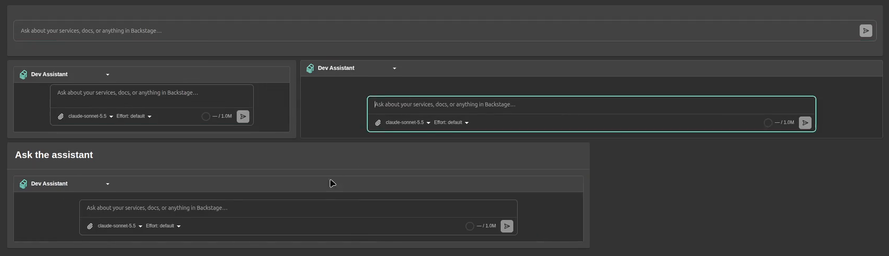

# Chat page, panel, and homepage

## Chat page

- Conversations: one list per assistant; a row's menu renames, pins, or
  deletes it, and pinned conversations sort first.
- Assistant details: the info button shows an assistant's description, tools
  grouped by source, and models.
- A new conversation opens on a welcome with the assistant's description and
  its starter suggestions; a suggestion sends immediately.
- Replies have Copy, Copy as rich text (for Teams, Outlook, email), and
  Regenerate, with a picker between regenerated branches. Reasoning shows in a
  collapsible block; a tool call without its own UI shows its input and output
  on expand.
- The composer holds the model and reasoning effort pickers, takes images
  (picked or pasted) and text and code files up to 7 MB each, shows a context
  gauge against the model's `contextWindow`, and stops a running reply. A stopped reply ends with "Request interrupted"; a
  dropped connection with "Connection lost".
- Attached images and SVG files open in a fullscreen pan-and-zoom preview.

## Panel

The panel puts a floating button in the lower right of every page. It opens a
side panel with one conversation at a time, beside the page rather than over
it: the page content makes room for it. "Open in Assistants" moves the
conversation to the full page; nothing is copied.

The panel wraps the app layout, which is the app plugin's own extension
point, so it ships as a module for the `app` plugin. Add it to your features
to turn it on:

```ts
import assistantsPlugin, {
  assistantsPanelModule,
} from '@drewswiredin/backstage-plugin-assistants/alpha';

export default createApp({
  features: [assistantsPlugin, assistantsPanelModule],
});
```

The panel opens the default assistant, the one every signed-in user gets
(designated in the editor with "Make default"). A user who can access more
than one assistant picks another from the menu on the assistant's name in the
panel header; the pick is remembered in that browser and starts a fresh
conversation. If the picked assistant goes away, the panel falls back to the
default. The history button in the header lists that assistant's earlier
conversations; picking one continues it in the panel. The model and reasoning
effort pickers sit in the composer, as on the page.

`Ctrl+/` (`⌘/` on macOS) toggles the panel. A click on the page or `Esc`
collapses it to a strip at the right edge with the conversation kept, unless
it is pinned: the pin in the header keeps it open while you work on the page,
for example to follow steps it gave you, and is remembered in this browser.
The strip's left edge is lit in the assistant's color; it glows onto the page
in a slow pulse while the assistant is working and holds the glow while a
reply is unread, as the dot on its icon does. Close (the x) removes the strip and brings the button back.
Backstage dialogs
and drawers, such as the entity inspector or a Kubernetes pod, open beside the
panel instead of over it, and clicking or typing in the panel leaves them
open.
Dragging the left edge resizes the panel, double-clicking it goes back to the
default width, and below tablet width it fills the screen. The panel remembers your last quick conversation in this browser; only
"+" and "Open in Assistants" start fresh. Tools, approvals, forms, and
attachments work as on the page. The button is hidden on the Assistants page
itself and for users without `assistant.use`.

The panel tells the assistant which page it sits beside (the path, the title,
and the catalog entity when the page is one), and the assistant can read the
page itself with the built-in `read_current_page` tool: headings, text,
buttons, links, tabs, form fields, tables, alerts, graph labels, TechDocs
content, any open dialog, and the lines of a log around a term. So "what does this mean" and "which button do I
press" work on any page, with no per-plugin code. The tool shows as a chip in
the conversation when it runs. To turn it off for the whole app:

```yaml
app:
  extensions:
    - assistant-client-tool:assistants/read-current-page: false
```

The assistant also knows what this Backstage instance offers through the
built-in `describe_portal` tool: the installed plugins, every page with its
path, and the tabs on a catalog entity's page (Kubernetes, CI, API
definitions, and so on), read from the app tree every new-frontend-system app
builds. So "what's in Backstage" and "where do I find our API docs" get an
answer, with links, from any page, and without the visualizer plugin. Turn it
off the same way, with
`assistant-client-tool:assistants/describe-portal: false`.

An assistant can also take the user to a page with the built-in
`portal__navigate` tool: "open the orders API" opens it, and the conversation carries on
in the panel beside it, including a conversation started on the Assistants
page. The tool takes a path in this portal (query and hash kept); it refuses
other sites, `/api` routes, and script URLs, and it doesn't check permissions,
so a page the user can't see shows Backstage's usual message. A path inside
the Assistants page opens the conversation there instead. It is a built-in,
so every assistant has it, and it is offered only when the app has the panel
module, which is where the conversation continues. Turn it off for the whole
app with
`assistant-client-tool:assistants/portal-navigate: false`.

## Homepage

A composer for an app that uses `@backstage/plugin-home`. It is the panel's
own surface with the conversation hidden, so the composer is the same one the
page and the panel use. The first send creates the conversation and hands it
to the panel, which opens and continues it, and the composer starts over; in
an app without the panel the conversation opens on the Assistants page.

It ships behind its own entry point, `/home`, and needs
`@backstage/plugin-home-react` in your app. That package is an optional peer
dependency, so the plugin never pulls it in and an app without a home page
never loads it, but your package manager won't install it for you either. Add
it next to `@backstage/plugin-home`:

```sh
yarn --cwd packages/app add @backstage/plugin-home-react
```

Then add the module to your features:

```ts
import { assistantsHomeModule } from '@drewswiredin/backstage-plugin-assistants/home';

export default createApp({
  features: [assistantsPlugin, assistantsPanelModule, assistantsHomeModule],
});
```

The module adds one widget, `AssistantComposer`. Its look is set with
`variant`:



| `variant`          | Looks like                                                                                                                                                         | Grid rows |
| ------------------ | ------------------------------------------------------------------------------------------------------------------------------------------------------------------ | --------- |
| `bar`              | The composer alone on one row, like a search bar: no header, no assistant picker, no model picker. It uses the user's last picked assistant, else the default one. | 2         |
| `padded` (default) | The assistant picker and the full composer (attachments, model, reasoning effort), framed inside the card's padding.                                               | 3         |
| `full`             | The same, filling the card edge to edge.                                                                                                                           | 3         |
| `titled`           | `padded` under a card header, like the other home cards. `title` sets the header text (default "Ask the assistant").                                               | 4         |

`width` sets the composer's width as a percentage of the card, 20 to 100: 100
by default for `bar`, like a search bar, and 80 for the others.

Configure the widget and place it on the home page's grid by its name:

```yaml
app:
  extensions:
    - home-page-widget:assistants/AssistantComposer:
        config:
          variant: bar
          width: 100
    - page:home:
        config:
          defaultConfig:
            - component: AssistantComposer
              column: 0
              row: 0
              width: 12
              height: 2 # the variant's grid rows
```

The composer's hint text is the assistant's own "Composer placeholder", set in
the editor, else "Ask about your services, docs, or anything in Backstage…".
For the `bar`, a placeholder such as "Ask anything about our systems…" on the
default assistant makes it read like a search box. A user's saved home layout
wins over `defaultConfig` until they choose "Restore defaults".

To render it somewhere else, such as inside your own card or page, use the
component the entry point exports:

```tsx
import { AssistantComposer } from '@drewswiredin/backstage-plugin-assistants/home';

<AssistantComposer variant="padded" width={90} />;
```

`full` assumes the home card's 16 px content padding; the other variants fit
any container.

## Generative UI

Four built-in client tools are always available and need no config:

- `render_form`: an inline form; the submitted values become the tool result.
- `download_file`: a download chip for a text file the assistant generates
  (CSV, JSON, Markdown, code, SVG), with Copy for text files.
- `read_current_page`: the page the user is looking at, as an outline (see
  [Panel](#panel)). An app can turn it off.
- `describe_portal`: this instance's plugins, pages, and entity tabs (see
  [Panel](#panel)). An app can turn it off.

Mermaid code blocks render as diagrams themed to the Backstage light or dark
mode, with a fullscreen pan-and-zoom view. Markdown renders with GitHub
Flavored Markdown, so tables, task lists, and strikethrough come through.

### Forms and scaffolder pickers

Assistants can show an inline form (the `render_form` tool) built from
Backstage scaffolder field extensions (owner, entity, and repo pickers, plus
any custom field), resolved at runtime from the app. With
`@backstage/plugin-scaffolder` registered the pickers populate from the
catalog; without it, forms render with plain inputs.

A scaffolder template's parameters render as-is, `ui:field` and `ui:options`
included, so an assistant can show a template's own form in the conversation and
run the template with the submitted values. See
[the actions that flow needs](tools.md#run-a-scaffolder-template-from-the-conversation).

## Customize the sidebar

The plugin's nav entry has the id `page:assistants`; in a custom
`NavContentBlueprint`, `take()` it to place it yourself. Its icon carries a
live dot: amber while any of the user's conversations is working, red while
one is unread, wherever it started.

The auto-registered nav entry is not permission-gated: a user without
`assistant.use` still sees it and lands on a "You are not permitted to use
assistants" page. To hide the plugin entirely for them, `take()` the entry
and render it behind a `usePermission(assistantUsePermission)` check:

```tsx
// packages/app/src/modules/nav/Sidebar.tsx
import type { ReactNode } from 'react';
import { Sidebar, SidebarItem } from '@backstage/core-components';
import { NavContentBlueprint } from '@backstage/plugin-app-react';
import { usePermission } from '@backstage/plugin-permission-react';
import { assistantUsePermission } from '@drewswiredin/backstage-plugin-assistants-common';

function IfAssistantsAllowed({ children }: { children: ReactNode }) {
  const { allowed } = usePermission({ permission: assistantUsePermission });
  return allowed ? <>{children}</> : null;
}

export const SidebarContent = NavContentBlueprint.make({
  params: {
    component: ({ navItems }) => {
      const nav = navItems.withComponent(item => (
        <SidebarItem icon={() => item.icon} to={item.href} text={item.title} />
      ));
      const assistants = nav.take('page:assistants');
      return (
        <Sidebar>
          {nav.take('page:catalog')}
          <IfAssistantsAllowed>{assistants}</IfAssistantsAllowed>
          {nav.rest({ sortBy: 'title' })}
        </Sidebar>
      );
    },
  },
});
```

A sidebar item you build yourself gets the same dot from
`<AssistantsNavIcon />`.
