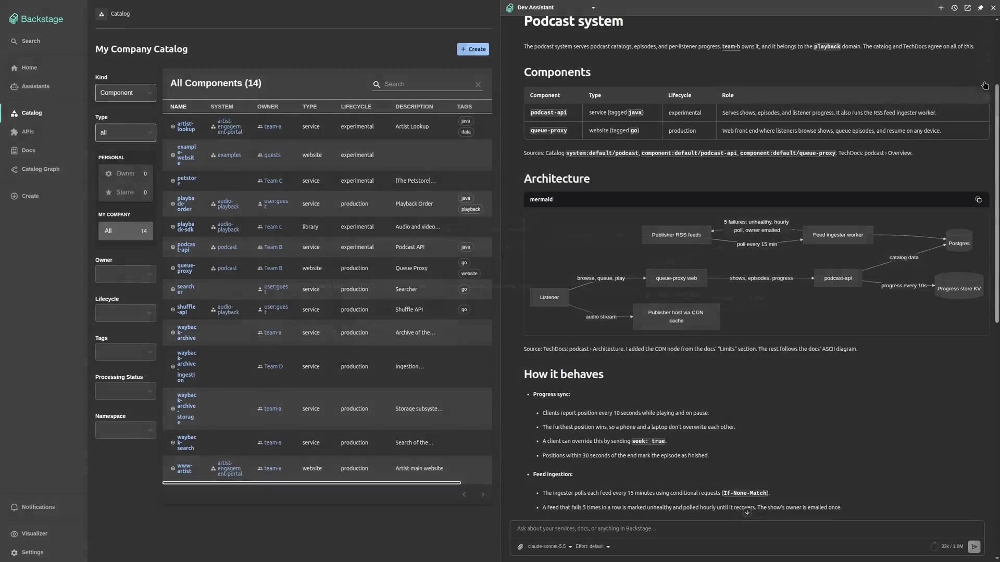
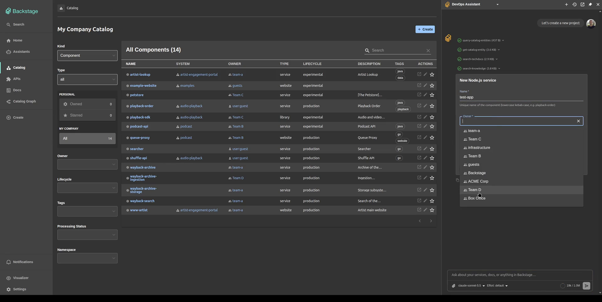

# AI Assistants for Backstage

Chat assistants that answer from your catalog and TechDocs, and run Backstage
actions and MCP tools as the signed-in user. Admins build them in-app.

## What it does

- **Answers from your catalog and docs.** Assistants search the catalog and
  TechDocs and read the pages they find. The
  [semantic search module](semantic-search.md) adds search by meaning over
  everything Backstage search indexes.
- **Acts as the user.** An assistant can look up entities, search docs, or run
  a scaffolder template with the permissions of the person asking.
- **Calls MCP servers.** Under a credential you configure, or as each user
  with their own sign-in.
- **Asks before it writes.** The tools you choose wait for an Allow in the
  conversation.
- **Lives where people work.** A full chat page, a panel beside any page that
  can read that page and open another with the conversation following, and a
  composer on the home page.
- **Is managed in-app.** Admins create assistants with a prompt, models,
  tools, and an audience; changes are live on save.

## Start here

- [Getting started](getting-started.md): install, configure a provider, and
  talk to the first assistant.
- [Chat page, panel, and homepage](frontend.md): the three surfaces and how to
  turn them on.

## Configure

- [Model providers](providers.md)
- [Actions and tools](tools.md)
- [MCP servers](mcp.md)
- [Approvals](approvals.md)
- [Permissions](permissions.md)
- [Semantic search](semantic-search.md)

## Operate

- [Run in production](production.md): replicas, upgrades, logs, and
  troubleshooting.
- [Security](security.md): what leaves the cluster, what is stored, and prompt
  injection.
- [Reference](reference.md): configuration keys, startup errors, HTTP routes,
  and frontend exports.

## Extend

- [Client tools](client-tools.md): contribute a tool that runs in the browser
  as the user.
- [Add a provider type](providers.md#add-a-provider-type-from-a-backend-module)
  from a backend module.

## Packages

| Package                                                                    | Role                                  |
| -------------------------------------------------------------------------- | ------------------------------------- |
| `@drewswiredin/backstage-plugin-assistants`                                | Frontend plugin (new frontend system) |
| `@drewswiredin/backstage-plugin-assistants-backend`                        | Backend plugin                        |
| `@drewswiredin/backstage-plugin-assistants-common`                         | Shared types and permissions          |
| `@drewswiredin/backstage-plugin-assistants-backend-module-semantic-search` | Semantic search module                |

Source: [github.com/drewswiredin/backstage-assistants](https://github.com/drewswiredin/backstage-assistants).
