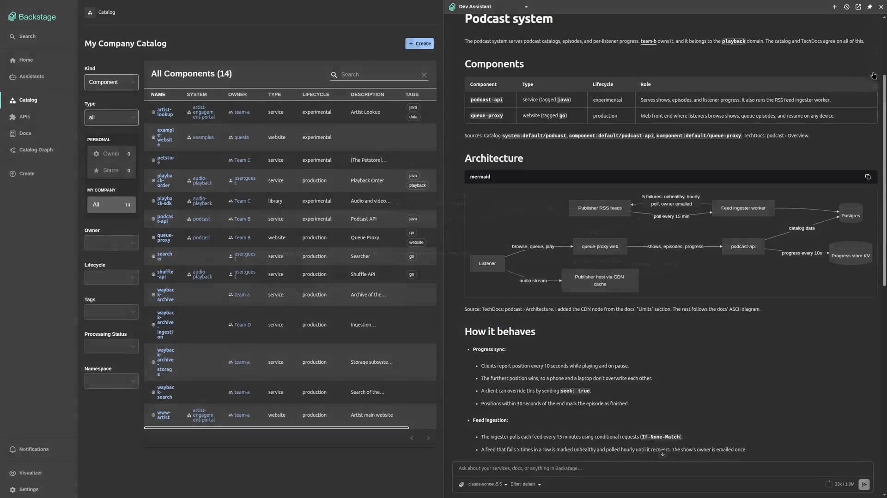

# @drewswiredin/backstage-plugin-assistants

The frontend plugin of
[AI Assistants for Backstage](https://github.com/drewswiredin/backstage-assistants):
chat assistants that answer from your catalog and TechDocs, and run Backstage
actions and MCP tools as the signed-in user.

It adds a chat page at `/assistants`, an optional panel that opens beside any
page, an optional composer for the home page, and the in-app editor where
admins create assistants. It needs the backend plugin,
[`@drewswiredin/backstage-plugin-assistants-backend`](https://www.npmjs.com/package/@drewswiredin/backstage-plugin-assistants-backend).

**Docs: [drewswiredin.github.io/backstage-assistants](https://drewswiredin.github.io/backstage-assistants/)**

[](https://github.com/user-attachments/assets/5891c498-5181-42d7-81bb-1af57e4d465c)

## Requirements

- Backstage 1.56 or later, on the new frontend system
  (`@backstage/frontend-defaults` `createApp`). It does not mount in a legacy
  app built on `@backstage/app-defaults`.
- Node 22.12 or later.
- React 18 and `react-router-dom` ^6.30.2 (peer dependencies).

## Install

```bash
yarn --cwd packages/app add @drewswiredin/backstage-plugin-assistants
yarn --cwd packages/backend add @drewswiredin/backstage-plugin-assistants-backend
```

```ts
// packages/app/src/App.tsx
import { createApp } from '@backstage/frontend-defaults';
import assistantsPlugin, {
  assistantsPanelModule, // optional: the panel beside every page
} from '@drewswiredin/backstage-plugin-assistants/alpha';

export default createApp({
  features: [assistantsPlugin, assistantsPanelModule],
});
```

Then add the backend plugin and an `assistants` block to `app-config.yaml`;
[Getting started](https://drewswiredin.github.io/backstage-assistants/getting-started/)
has the steps.

## Documentation

- [Getting started](https://drewswiredin.github.io/backstage-assistants/getting-started/)
- [Chat page, panel, and homepage](https://drewswiredin.github.io/backstage-assistants/frontend/):
  turning on the panel and the homepage composer, and customizing the sidebar
- [Client tools](https://drewswiredin.github.io/backstage-assistants/client-tools/):
  contribute a tool that runs in the browser as the user
- [Frontend exports](https://drewswiredin.github.io/backstage-assistants/reference/#frontend-exports)

## License

Apache-2.0. Includes MIT-licensed components from assistant-ui, listed in
`THIRD_PARTY_NOTICES.md`, shipped with this package.
